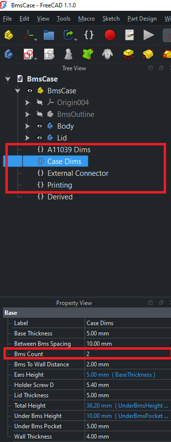

# A11039 BmsCase

Model created using FreeCad 1.1.0.

Most driving dimensions are kept in varsets. To change the design, edit values in the VarSets rather than in the sketches. Model is recomputed from them.

---

## Common changes

- **Different number of boards:** change `Case Dims.BmsCount`. The height, centering posts, lid position and number of vent rows update automatically.
- **Tighter or looser fits:** change `Printing.Tolerance` (general fits) or `External Connector.Tolerance` (connector opening only).
- **Thicker or thinner shell:** change `WallThickness`, `BaseThickness` and `LidThickness`. Nut and screw-head recess depths follow automatically.

## 1. `Case Dims`: case geometry

Main case parameters. **`BmsCount` is the main setting**: set it to the number of stacked boards.

| Property | Default | Description |
|---|---|---|
| `BmsCount` | 2 | Number of stacked BMS boards (integer) |
| `BmsToWallDistance` | 2 mm | Horizontal clearance between the board and the inner wall |
| `HolderScrewD` | 5.4 mm | Hole diameter for the screws in the mounting ears |
| `WallThickness` | 4 mm | Side-wall thickness |
| `BaseThickness` | 5 mm | Solid floor thickness under the pocket |
| `LidThickness` | 5 mm | Lid thickness |
| `EarsHeight` *(expr)* | 5 mm | `= BaseThickness`: thickness of the mounting ears |

next properties less important

| Property | Default | Description |
|---|---|---|
| `UnderBmsPocket` | 5 mm | Depth of the pocket under the bottom board (room for solder joints and components) |
| `BetweenBmsSpacing` | 10 mm | Vertical gap between two stacked boards (standoff length) |
| `UnderBmsHeight` *(expr)* | 10 mm | `UnderBmsPocket + BaseThickness`: total base height under the bottom board |
| `TotalHeight` *(expr)* | 36.2 mm | `UnderBmsHeight + LidThickness + Thickness·BmsCount + ConnectorHeight + BetweenBmsSpacing·(BmsCount−1)`: overall case height (wall pad, `CaseTop` plane, lid placement) |

## 2. `Printing`: 3D-printer settings

Printer-dependent values. Adjust these to your printer or slicer before you export STL.

| Property | Default | Description | Used by |
|---|---|---|---|
| `Tolerance` | 0.2 mm | General fit clearance | Nut traps, screw counterbores, centering posts, holder-screw holes |
| `LayerHeight` | 0.2 mm | Slicer layer height | `SupportFreePrint*` bridging layers (1× and 2× layer height) in the case and lid |
| `NozzleD` | 0.4 mm | Nozzle diameter | Wall width of the centering features (`2 × NozzleD`) |

---

## 3 In most cases shouldn't be changed
### 3.1. `A11039 Dims`: BMS board

Physical dimensions of a single A11039 BMS board. Shouldn't be changed in most cases.

| Property | Default | Description | Used by |
|---|---|---|---|
| `Length` | 99 mm | Board length | Board sketch, lid screw-hole positions |
| `Width` | 56.8 mm | Board width | Board sketch, lid screw-hole positions |
| `Thickness` | 1.6 mm | PCB thickness | Stack height, `BmsTop` plane, `BmsCentering` posts |
| `HoleD` | 3.5 mm | Mounting-hole diameter | Board sketch, screw-hole positions |
| `HoleToBorder` | 3.8 mm | Distance from the board edge to the mounting-hole edge | Board sketch, screw-hole positions, centering posts |
| `ConnectorHeight` | 8 mm | Height of the connectors above the top board | Stack height, `PressurePoint` pad on the lid |

### 3.2. `External Connector`: side connector cut-out

Size of the board's edge connector that goes through the case wall (`ConnectorPocketSide`, `ConnectorPocket001` and the matching lid pockets).

| Property | Default | Description |
|---|---|---|
| `Height` | 11.2 mm | Connector height |
| `StepDown` | 3.3 mm | How far the connector reaches below the top face of the board |
| `StepDownFromBoard` *(expr)* | 1.7 mm | `StepDown − A11039 Dims.Thickness`: how far it reaches below the bottom of the PCB |
| `Tolerance` | 0.4 mm | Clearance added to the cut-out (split ½ on each side) |

### 3.3. `Derived`: calculated values *(read-only)*

Intermediate values calculated from the other VarSets. All of them are expressions, so **don't edit them directly**.

| Property | Default | Formula | Used by |
|---|---|---|---|
| `FreeHeightSpace` | 26.2 mm | `UnderBmsPocket + BetweenBmsSpacing·(BmsCount−1) + Thickness·BmsCount + ConnectorHeight` | Number of ventilation-slot rows in `LinearPattern004–007`: `trunc((FreeHeightSpace ± 4 mm) / 9 mm)` |
| `NutHeight` | 4 mm | `min(UnderBmsHeight − UnderBmsPocket − 1 mm, 4 mm)` | Nut-trap depth in the base (`Pocket010`) |
| `ScrewHeadHoleHeight` | 4 mm | `min(LidThickness − 1 mm, 4 mm)` | Screw-head counterbore depth in the lid (`ScrewHeadHoles`) |

Both `NutHeight` and `ScrewHeadHoleHeight` keep at least 1 mm of material under the recess. They are capped at 4 mm.
